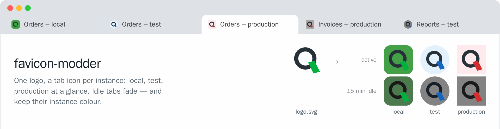
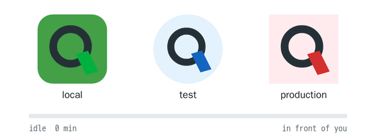
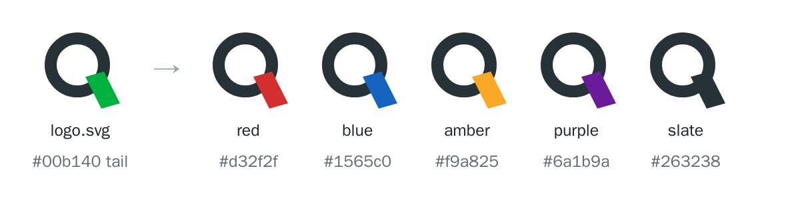
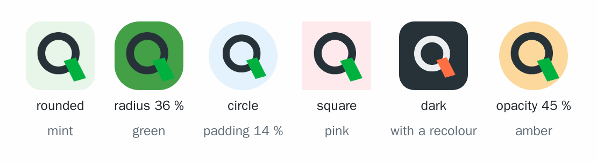
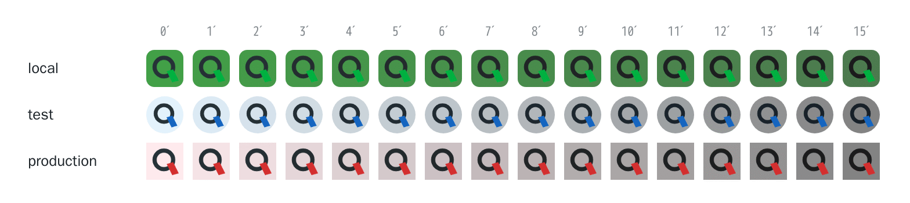
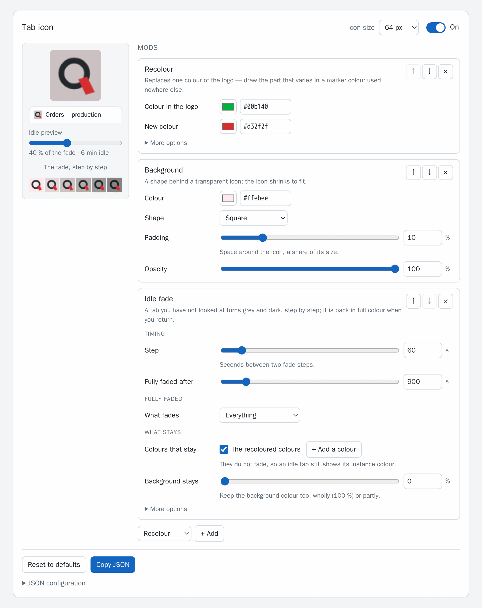
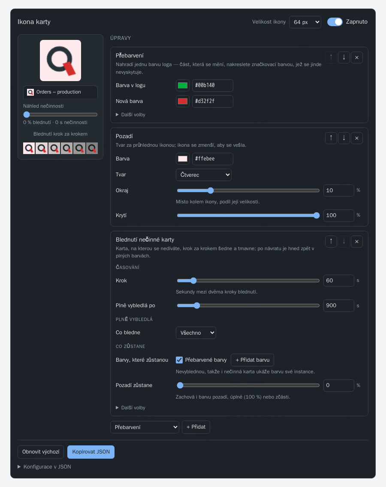

# favicon-modder

<p align="center"></p>

Redraw a page's favicon through a short pipeline of small **mods** — recolour part of the logo, put a shape
behind it, fade the icon while the tab sits idle — from **one JSON config per user**, with a **drop-in
configurator** to edit it. No dependencies, no build step, no framework.

> **Version 0.x — no compatibility promise.** The API and the config format may change in any 0.x release.
> Pin the exact version. (Stored configs carry a `version` and are migrated forward, see below.)

## Why

Orientation with many tabs open. The same app runs locally, on a test server and in production, and the
tabs all look alike. With favicon-modder each instance draws its own icon from the one logo:

- **local green, test blue, production red** — by recolouring a marker colour in the logo;
- a coloured square, rounded square or circle behind a transparent logo;
- **idle tabs fade** — a tab you have not looked at for a while turns grey and dark, step by step, and is
  back in full colour the moment you return. **The instance colour stays**: a faded production tab still
  has its red tail, so even the oldest tab tells you where it points.

It is meant as a per-user opt-in (developers, operators, managers who keep many tabs open), not something
every visitor gets: when nothing is configured, the page's favicon is left untouched.

<p align="center"></p>

## Quick start

A script tag (a global `FaviconModder`) and three lines:

```html
<script src="https://cdn.jsdelivr.net/npm/favicon-modder@0.3.0/dist/favicon-modder.min.js"></script>
<script>
  FaviconModder.fromConfig({
    mods: [{ type: 'recolor', from: '#00b140', to: '#d32f2f' }, { type: 'background', color: '#ffebee' }, { type: 'fade' }],
  }).start();
</script>
```

or an ES module:

```js
import FaviconModder from 'favicon-modder';                 // npm / a bundler
import FaviconModder from './vendor/favicon-modder.js';     // or a copy of src/favicon-modder.js

FaviconModder.fromConfig(JSON.parse(localStorage.getItem('favicon') || 'null') ?? FaviconModder.defaultConfig()).start();
```

The same pipeline can be built in code: `FaviconModder.create().recolor('#00b140', '#d32f2f').background('#ffebee').fade().start()`.

Files: `src/*.js` are ES modules; `dist/*.js` are UMD builds (global, CommonJS or AMD) and `dist/*.min.js`
their minified twins. The configurator is a separate file, `favicon-modder-ui.js` (below); the core does not
need it.

## The mods

Mods run in config order; the configurator keeps the fade last so it fades what the others drew.

### recolor — one logo, a colour per instance



```json
{ "type": "recolor", "from": "#00b140", "to": "#d32f2f", "tolerance": null }
```

Draw the part that varies in a marker colour that appears nowhere else in the logo — chroma green
`#00b140` is a good choice — and recolour that per instance. Several recolours stack.

- **SVG sources** are recoloured in the SVG itself, before it is rasterised: the `fill`, `stroke`,
  `stop-color`, `flood-color`, `lighting-color` and `color` attributes, `style="…"` and `<style>` CSS. Every
  notation is compared as a colour — `#rgb`, `#rrggbbaa`, `rgb()`, `hsl()`, named colours.
- **Raster sources** (PNG, ICO) get a pixel swap on the canvas.
- `tolerance` (0–255 per RGB channel): `null` = automatic — exact for SVG, 32 for raster icons.

### background — a shape behind a transparent icon



```json
{ "type": "background", "color": "#e8f5e9", "shape": "rounded", "radius": 0.22, "padding": 0.1, "opacity": 1 }
```

| option | default | |
|---|---|---|
| `color` | `#e8f5e9` | any CSS colour |
| `shape` | `rounded` | `square`, `rounded` or `circle` |
| `radius` | `0.22` | corner radius of `rounded`, a fraction of the size |
| `padding` | `0.1` | the icon shrinks by this fraction on every side |
| `opacity` | `1` | of the shape only |

### fade — idle tabs turn grey and dark, and keep their tint



```json
{ "type": "fade", "step": 60, "after": 900, "easing": "linear", "target": "all",
  "keep": ["recolored"], "keepBackground": 0, "saturation": 0, "brightness": 0.55,
  "tolerance": 48, "keepStrength": 1 }
```

| option | default | |
|---|---|---|
| `step` | `60` | seconds between two fade steps |
| `after` | `900` | seconds of idle until the fade is complete |
| `easing` | `linear` | `linear`, `ease-in`, `ease-out`, `ease-in-out` |
| `target` | `all` | `all`, `icon` (the logo only) or `background` (the shape only) |
| `saturation`, `brightness` | `0`, `0.55` | the look at full fade |
| `keep` | `["recolored"]` | colours of the logo that do not fade; `"recolored"` stands for the `to` of every recolour; `[]` fades everything |
| `keepBackground` | `0` | 0–1: how much of the background colour stays (`0.6` keeps a green "local" shape recognisable) |
| `tolerance` | `48` | how far a pixel may be from a kept colour and still count as it (anti-aliased edges are split, so the tail gets no grey halo) |
| `keepStrength` | `1` | 0–1: how much of the fade a kept colour escapes |

**Idle** is the time since the tab was last in front of the user — visible and focused — or since they last
clicked, typed or scrolled in it. The tab in front of you never fades; coming back resets it at once. The
step timer runs in a tiny inline Web Worker so background-tab throttling does not stall it (with a
`setTimeout` fallback where workers are blocked by a CSP).

## The config

One plain JSON object — what you store per person:

```json
{
  "version": 1,
  "enabled": true,
  "size": 64,
  "mods": [
    { "type": "recolor", "from": "#00b140", "to": "#1565c0" },
    { "type": "background", "color": "#e3f2fd", "shape": "circle", "padding": 0.14 },
    { "type": "fade", "after": 600 }
  ]
}
```

```js
const fm = FaviconModder.fromConfig(config, { source: 'auto' });   // a controller; nothing changes yet
fm.start();              // draws (a no-op with "enabled": false)
fm.setConfig(next);      // live: redraws, stops on enabled: false, starts again on true
fm.toConfig();           // back to JSON — also for a pipeline built in code
fm.stop();               // the original icon is back
```

- **Left-out options take their defaults**; an invalid value (a colour that is not one, a number out of
  range) falls back to the default. `FaviconModder.normalizeConfig(json)` returns `{ config, warnings }`
  without building anything; `FaviconModder.defaultConfig()` is a fade-only starting point.
- **Forward and backward tolerant.** An unknown mod type or option is not applied and is reported in one
  `console.warn` — but it is **kept** by `toConfig()`, so an app on an older library version does not erase
  what a newer one stored.
- **Versioned.** `version` is the config format (`FaviconModder.configVersion`, now 1). A config without one
  is taken as current; an older one passes through the registered migrations:
  `FaviconModder.registerMigration(1, (config) => upgradedToVersion2)`.
- `fromConfig(config, opts)` takes the `create()` options: `source` (`'auto'` = the page's
  `<link rel="icon">`, or a URL), `size` (overrides the config's), `target` (a `<link>` or an ``).
- `fm.preview(time)` freezes time-dependent mods at a point of their course (0–1 of the fade's `after`),
  for previews; `preview(null)` gives them their clock back.

## The configurator

<p align="center"></p>

`favicon-modder-ui.js` renders an editor for that JSON — embed it in a settings page of every app and keep
one config per person. It is **drawn entirely from the mod registry**: when you upgrade the library and a
new mod or option appears, it appears in the configurator too, with no change to your app.

```html
<script src="https://cdn.jsdelivr.net/npm/favicon-modder@0.3.0/dist/favicon-modder.min.js"></script>
<script src="https://cdn.jsdelivr.net/npm/favicon-modder@0.3.0/dist/favicon-modder-ui.min.js"></script>
<div id="favicon-settings"></div>
<script>
  const store = FaviconModderUI.localStorageStore('favicon');          // { load(), save(config), clear() }
  const tab = FaviconModder.fromConfig(store.load() ?? FaviconModder.defaultConfig()).start();

  FaviconModderUI.mount(document.getElementById('favicon-settings'), {
    config: store.load(),
    onChange(config) { store.save(config); tab.setConfig(config); },   // store it, and show it on this tab
  });
</script>
```

Storing on your server instead (debounce: `onChange` fires on every slider move):

```js
let timer;
FaviconModderUI.mount(el, {
  config: await (await fetch('/me/favicon-config')).json(),
  onChange(config) {
    clearTimeout(timer);
    timer = setTimeout(() => fetch('/me/favicon-config', {
      method: 'POST', headers: { 'Content-Type': 'application/json' }, body: JSON.stringify(config),
    }), 500);
  },
});
```

`mount(element, options)` → `{ getConfig(), setConfig(config), setLocale(locale), destroy(), root }`

| option | default | |
|---|---|---|
| `config` | `defaults` | the config to edit |
| `onChange(config)` | — | called with the full, checked JSON after every edit; storing it is the host app's job |
| `defaults` | `FaviconModder.defaultConfig()` | what "Reset to defaults" restores |
| `locale` | `<html lang>`, else the browser's | `'en'`, `'cs'`, or any language added with `addMessages()` |
| `messages` | — | `{ key: text }` overrides for this instance |
| `preview` | `true` | the live preview: 64 px, a fake tab at 16 px, an idle slider (0–100 % of the fade) and a six-step strip |
| `source` | the page's icon | the icon to preview (a running controller marks the original on the link, so the preview never draws a drawn icon) |
| `allowedMods` | all | mod types the "Add" menu offers, e.g. `['recolor', 'fade']` |
| `theme` | `'auto'` | `'auto'` (follows `prefers-color-scheme`), `'light'` or `'dark'` |
| `title`, `tabTitle` | — | the heading and the fake tab's text |

What it shows: an on/off switch (`enabled`), the icon size, one card per mod (move up / down, remove,
"More options" for the rarely needed ones), an "Add" menu, **Reset to defaults**, **Copy JSON** and the JSON
itself. `setConfig()` shows another config without calling `onChange`.

**Styling.** It lives in a Shadow DOM — nothing leaks in or out. Theme it with CSS custom properties on the
host element: `--fmui-accent`, `--fmui-bg`, `--fmui-fg`, `--fmui-border`, `--fmui-muted`, `--fmui-panel`,
`--fmui-radius`, `--fmui-font`. Native controls, labels on every field, a keyboard-operable switch,
`aria-live` status messages.

```css
#favicon-settings { --fmui-accent: #8e24aa; --fmui-radius: 4px; }
```

### Languages



English and Czech are built in. Add a language, or change a few words:

```js
FaviconModderUI.addMessages('de', {
  'ui.reset': 'Zurücksetzen', 'ui.copy': 'JSON kopieren',
  'mod.fade': 'Ausblenden im Leerlauf', 'mod.fade.after': 'Ganz verblasst nach',
});
FaviconModderUI.mount(el, { locale: 'de-AT' });          // de-AT → de → en → the schema's own text
FaviconModderUI.mount(el, { messages: { 'ui.title': 'Your tab icon' } });
```

Keys: `ui.*` for the configurator, `mod.<type>` / `mod.<type>.help` for a mod, `mod.<type>.<option>` (and
`.help`) for a field, `mod.<type>.<option>.<value>` for a choice, `mod.<type>.group.<group>` for a group
heading. `FaviconModderUI.messages.en` and `.cs` list them all. A missing text falls back to English, then to
the English label in the mod's schema — so a third-party mod is labelled without any translation.

<br clear="right">

## Writing your own mod

A mod is a plain object with any of these hooks:

```js
const mod = {
  name: 'badge',                 // for remove('badge') / get('badge')
  prepare(state) {},             // every render, first (e.g. state.accents.push(colour) — the fade keeps it)
  svg(doc, state) {},            // vector stage: change the parsed SVG document in place
  canvas(ctx, state) {},         // raster stage: ctx is the icon layer; state.layers.background is behind it
  attach(controller) {},         // start(): timers, listeners …
  detach() {},                   // stop() / remove(): … torn down
  preview(time) {},              // optional: show yourself at 0–1 of your course
  toConfig() { return {}; },     // optional: your options now (default: what the config gave you)
};
FaviconModder.create().use(mod).start();
```

**Register it with a schema** and it becomes configurable — `fromConfig()` builds it and the configurator
shows it, labelled, with no change to the UI:

```js
FaviconModder.registerMod('dot', (o) => ({
  name: 'dot',
  canvas(ctx, { size }) {
    ctx.fillStyle = o.color;
    ctx.beginPath();
    ctx.arc(size * 0.8, size * 0.2, size * o.radius, 0, Math.PI * 2);
    ctx.fill();
  },
}), {
  label: 'Dot', help: 'A dot in the top-right corner.',
  options: [
    { key: 'color', type: 'color', default: '#e53935', label: 'Colour' },
    { key: 'radius', type: 'number', min: 0.05, max: 0.3, step: 0.01, percent: true, default: 0.18, label: 'Size' },
  ],
});

FaviconModder.fromConfig({ mods: [{ type: 'dot', color: '#ff6f00' }] }).start();
```

Option schema fields: `key`, `type` (`color`, `number`, `select`, `boolean`, `colorList`, `text`),
`default`, `label` / `help` (English fallbacks), `labelKey` / `helpKey` (other message keys), `group`,
`min` / `max` / `step` / `unit`, `percent` (a 0–1 fraction shown in %), `nullable` (empty = automatic),
`options: [{ value, label }]` (select), `tokens: [{ value, label }]` (words a colour list may hold, like
`recolored`), `when: { otherKey: value }` (shown only then), `advanced` (under "More options"). Schema-level:
`label`, `help`, `groups`, `single` (one per pipeline), `position: 'last'`. `FaviconModder.modTypes()` and
`modSchema(type)` read the registry. The built-in `recolor`, `background` and `fade` are registered exactly
this way.

The pure helpers the built-ins use are exported too: `parseColor`, `formatColor`, `colorMatcher`,
`recolorCss`, `recolorSvgString`, `recolorSvgDoc`, `recolorPixels`, `fadePixels`, `resolveKeep`,
`keepWeight`, `fadeLevel`, `nextFadeTick`.

## The code API, in short

`FaviconModder.create(opts)` → controller, chainable: `recolor(from, to, opts)`, `background(color, opts)`
(again = change live, `null` = remove), `fade(opts)` (`false` = remove), `use(mod)`, `remove(modOrName)`,
`get(name)`, `onlyIf(boolOrFn)`, `start()`, `stop()`, `redraw()`, `setConfig()`, `toConfig()`,
`preview()`. The fade also accepts `level` (a frozen 0–1 level) and `now` (a clock, for tests).
`FaviconModder.enabled(key)` / `toggle(key, on)` are a one-switch localStorage opt-in, for when you do not
need a whole config.

## Browser notes and limits

- **Cross-origin icons** without CORS headers taint the canvas; the icon is then left as it is, with one
  `console.warn`. Serve the icon from the page's origin.
- **Frozen and discarded tabs** run no script, so their icon updates when they wake up.
- **Several icon links**: the first `<link rel~="icon">` is rewritten; keep a single `rel="icon"` link on
  pages that use the library, or the browser may prefer another one.
- **SVG without a `viewBox`** is drawn at its own `width`/`height`; with one it is scaled to `size`.
- Safari shows favicons in fewer places and caches them; Chromium browsers and Firefox update the tab icon
  at once.
- A redraw is a 64 px canvas — well under a millisecond of pixel work.
- The configurator needs Shadow DOM and container queries (every current browser).

## Playground

`demo/index.html` is a playground on the configurator: preset cards (local, test, production, a 30-second
idle fade) with their JSON, the configurator driving the tab's own icon, and the fade strip. ES modules do
not load from `file://`, so serve the project folder and open `/demo/`:

```bash
python3 -m http.server 8000      # then http://localhost:8000/demo/
npx serve .                       # or any static server
```

`?preset=test` loads a preset, `?lang=cs` switches the language.

## Develop

No Node or Bun is needed on the host — run everything in a container:

```bash
docker run --rm -v "$PWD":/w -w /w oven/bun bun test              # unit tests
docker run --rm -v "$PWD":/w -w /w oven/bun bun scripts/build.js  # dist/ (UMD + minified, core and UI)
```

## Licence

MIT — Copyright (c) 2026 jioolk. See [LICENSE](LICENSE).
